# Smart Home Server

  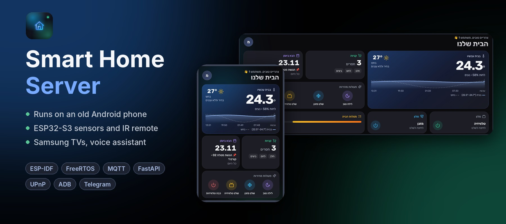

A complete smart-home platform that runs on an **old Android phone**. An **ESP32-S3** measures the climate and drives the air conditioner over IR, two **Samsung TVs** and two **Android TV boxes** are controlled over the network, and one mobile-first web app brings it all together for two users. An AI assistant understands Hebrew and is available in the app and on **Telegram**, including voice messages.

No cloud server, no subscription, no open ports on the router: everything runs at home, and access from outside goes through a private VPN (Tailscale).

> **Status:** in daily use at home. This repository is an overview of the project; the source code will be published here after a cleanup pass.

The interface is in Hebrew (right-to-left). Names and personal details in the screenshots were replaced with placeholders.

---

## What it does

- **Climate monitoring:** an ESP32-S3 with a DHT22 sensor reports temperature and humidity over MQTT. The app shows home and outside side by side, with a 24-hour graph and a 7-day forecast.
- **AC remote over IR:** the ESP32 learns each button from the original AC remote and replays it on request.
- **Two Samsung TVs:** a modern Tizen TV over WebSocket and UPnP, and a 2013 model through a driver I wrote for Samsung's legacy remote protocol. That TV has no Wake-on-LAN, so it is powered on through the TV box over HDMI-CEC.
- **TV boxes over ADB:** each box is identified by its serial number and followed automatically when its network address changes.
- **AI assistant in the app and on Telegram:** free Hebrew, text or voice. It remembers the conversation, knows the state of the home, and runs commands through the same verified code as the remote.
- **My matches:** live games with lineups drawn on a pitch, league tables, a Telegram reminder before kick-off, and a button that switches the living-room box to the right channel when the game starts.
- **Safe deploys:** one double-click from the laptop checks, backs up, installs and restarts only what changed, and rolls back automatically if the server does not come back.
- **Everyday features:** shopping list, chores, calendar, recipe book, workouts, nutrition and a semester dashboard. Two users, each with their own theme (dark and light).
- **Works like a phone app:** on an iPhone the site is added to the home screen and opens full-screen with its own icon.

**By the numbers:** about 12,500 lines of Python and 13,500 lines of HTML/CSS/JS, 126 API endpoints, 20 routers, 32 services, 12 background tasks.

## Screenshots

### Home screen, two themes

<table>
  <tr>
    <td width="50%" valign="top">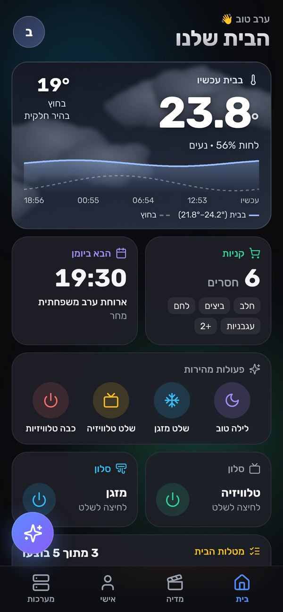 <b>Dark theme</b> (user A)</td>
    <td width="50%" valign="top">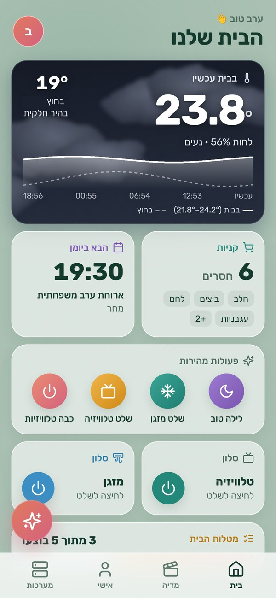 <b>Light theme</b> (user B)</td>
  </tr>
</table>

### Remotes

<table>
  <tr>
    <td width="33%" valign="top">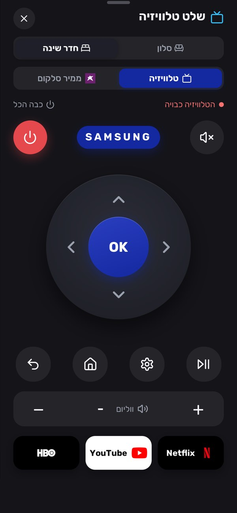 <b>Bedroom TV</b> (Tizen), with a TV/box toggle and exact volume</td>
    <td width="33%" valign="top">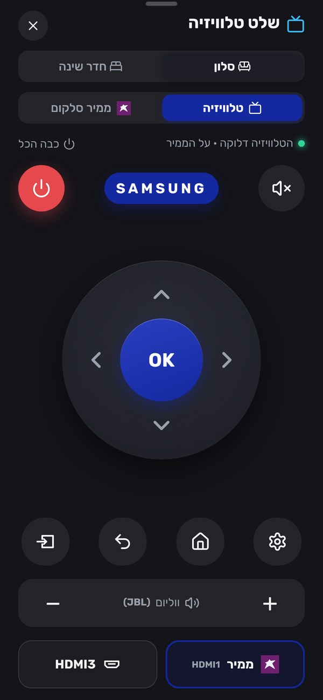 <b>Living-room TV</b> (2013 model, legacy protocol), inputs switched over UPnP</td>
    <td width="33%" valign="top">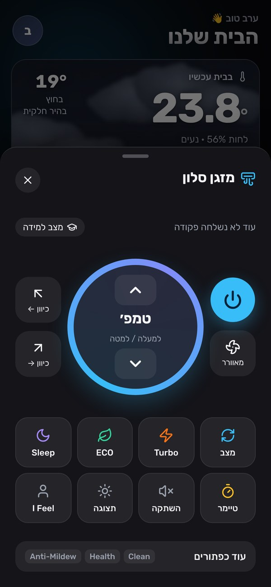 <b>AC</b> (IR through the ESP32), with a learning mode</td>
  </tr>
</table>

### My matches

<table>
  <tr>
    <td width="33%" valign="top">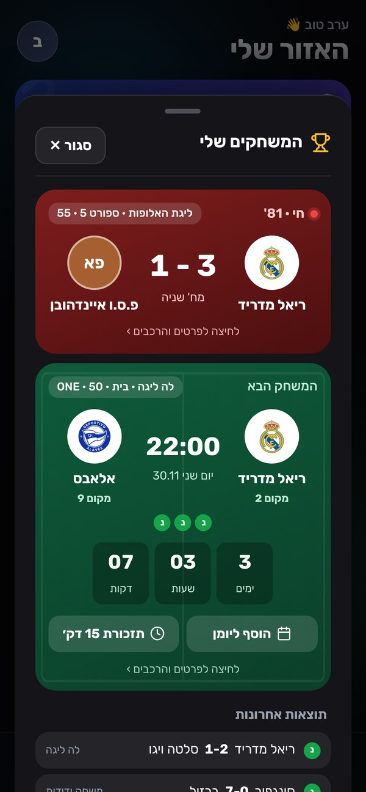 <b>Live score</b> and a countdown to the next match</td>
    <td width="33%" valign="top">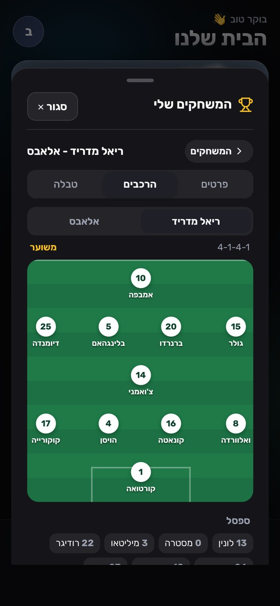 <b>Lineups</b> drawn on a pitch</td>
    <td width="33%" valign="top">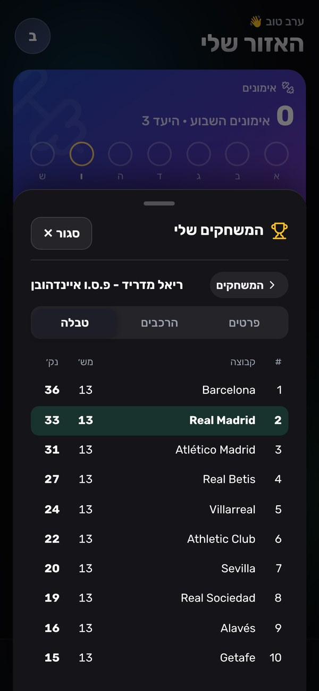 <b>League table</b> with both teams highlighted</td>
  </tr>
</table>

### Weather and personal area

<table>
  <tr>
    <td width="50%" valign="top">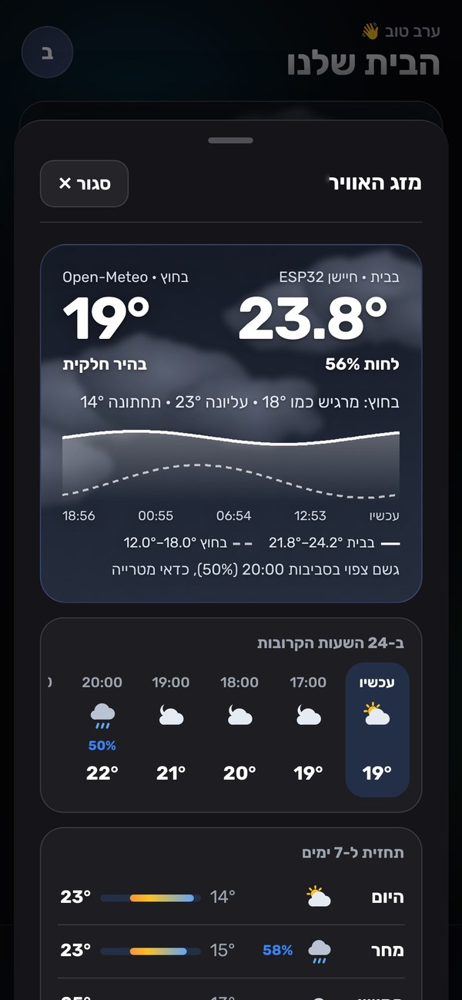 <b>Weather:</b> home (ESP32 sensor) vs outside (Open-Meteo), hourly and 7-day forecast</td>
    <td width="50%" valign="top">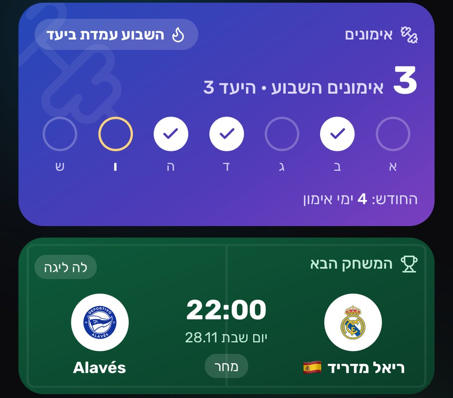 <b>Personal area:</b> weekly workout goal and the next match   <b>Recipe book</b></td>
  </tr>
</table>

### Assistant and maintenance

<table>
  <tr>
    <td width="33%" valign="top">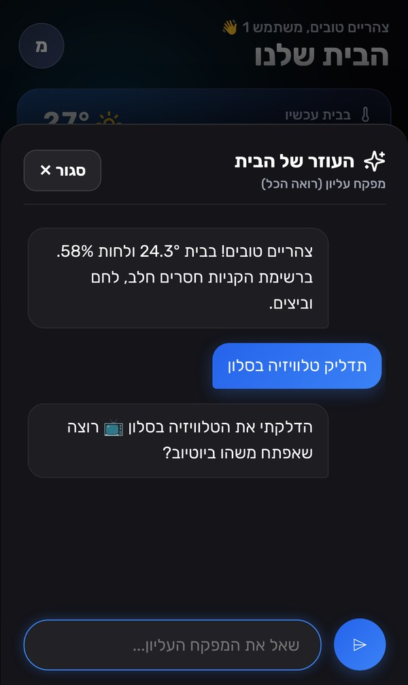 <b>AI assistant</b> turning on the living-room TV</td>
    <td width="33%" valign="top">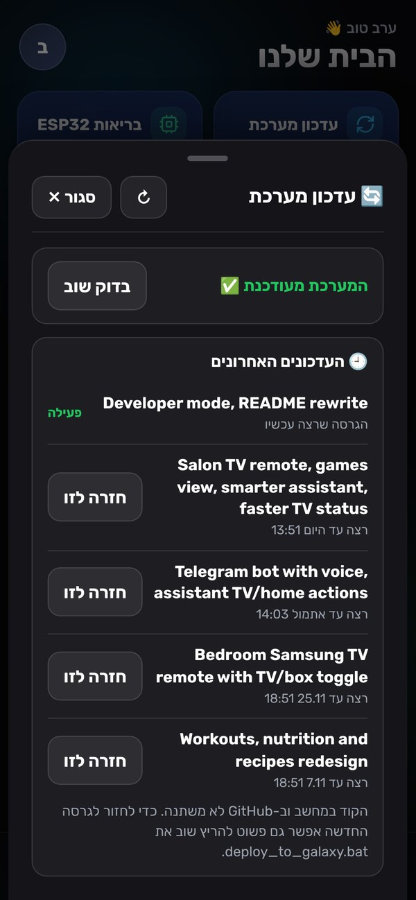 <b>Updates:</b> deploy history with one-tap rollback</td>
    <td width="33%" valign="top">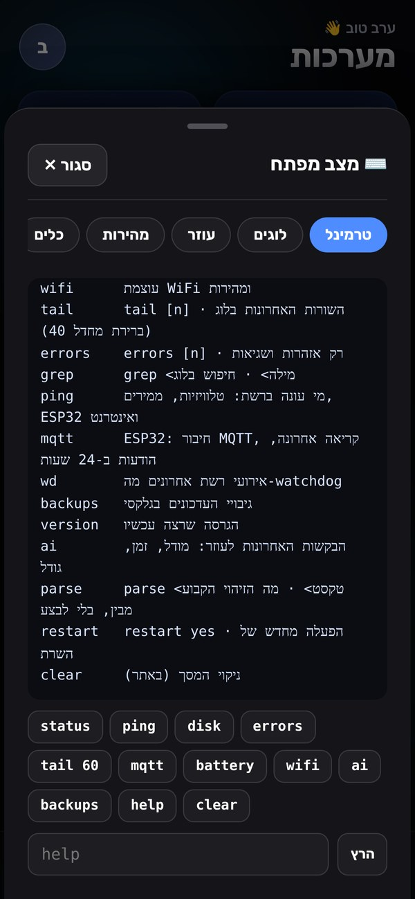 <b>Developer mode:</b> a whitelisted in-app terminal</td>
  </tr>
</table>

### Monitoring

<table>
  <tr>
    <td width="50%" valign="top"> <b>ESP32 health:</b> messages received vs expected, and an outage log with a probable cause</td>
    <td width="50%" valign="top"> <b>Server status:</b> battery, services, uptime and Wi-Fi of the phone</td>
  </tr>
</table>

## Architecture

## Hardware

<table>
  <tr>
    <td width="50%" valign="top">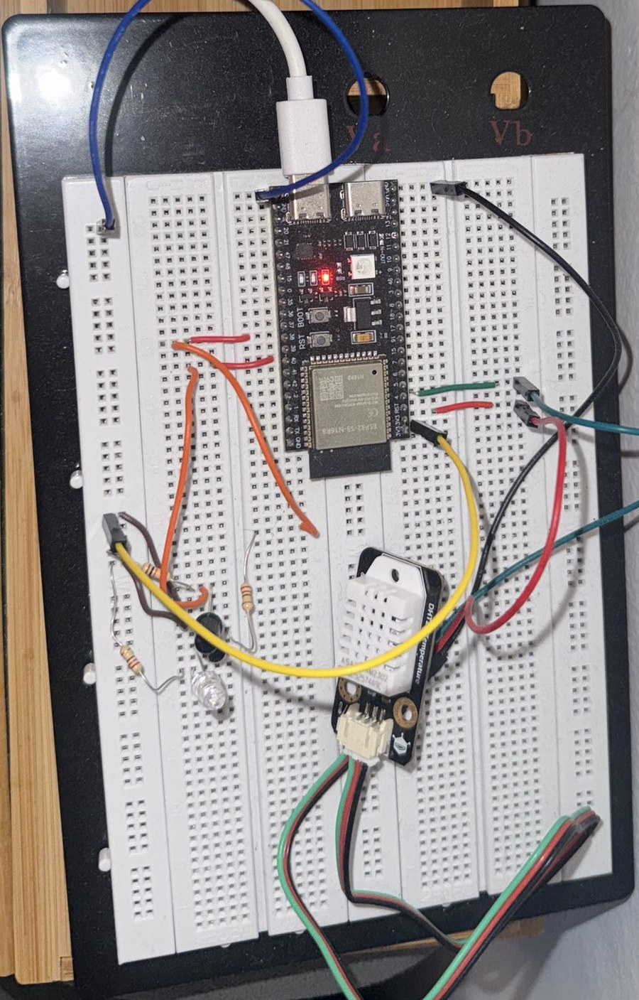 <b>ESP32-S3</b> prototype on a breadboard: DHT22 sensor, IR receiver and IR LED</td>
    <td width="50%" valign="top">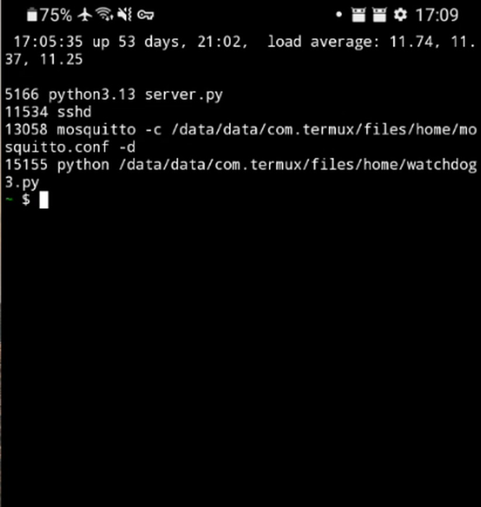 <b>The Galaxy A12 (SM-A127F) server</b> in Termux: 53 days of uptime, with the server, Mosquitto, SSH and the watchdog running</td>
  </tr>
</table>

| Part | Role |
|---|---|
| Samsung Galaxy A12 (Android 11, rooted with Magisk) | The server: Python, Mosquitto and a watchdog in Termux, 24/7 |
| ESP32-S3 (N16R8) | Sensor node and IR remote, written in C with ESP-IDF |
| DHT22 | Temperature and humidity |
| IR receiver + IR LED (through a transistor) | Learning and replaying AC remote codes with the ESP32 RMT peripheral |
| Samsung Tizen TV (bedroom) | WebSocket remote, exact volume through UPnP |
| Samsung TV, 2013 model (living room) | Legacy remote protocol (TCP 55000), inputs through UPnP, power-on through HDMI-CEC |
| 2 Android TV boxes | Controlled over ADB on the home network |

## Turning an old phone into a 24/7 server

- **Battery care:** rooted with Magisk; the [ACC](https://github.com/VR25/acc) module keeps the battery between 70% and 75% and pauses charging when it gets hot.
- **Less background work:** 38 preinstalled apps and automatic system updates are disabled, and only Wi-Fi is on.
- **Never put to sleep:** Termux is excluded from battery optimization and holds a wake lock.
- **Recovers on its own:** everything starts on boot, and a bootloop-protection module guards against bad Magisk modules.

Uptime at the time of writing: **53 days** without a reboot.

## Engineering highlights

**A driver for a 2013 TV.** The living-room TV only speaks Samsung's legacy remote protocol: a TCP connection on port 55000 with a one-time pairing and base64-encoded key frames. The driver keeps the socket open and reconnects by itself. Inputs are switched directly through UPnP, because on this model the HDMI keys can trigger unwanted picture modes. The TV cannot be woken over the network, so the server powers it on through the TV box over HDMI-CEC.

**Safe deploys with rollback.** Code is only edited on the laptop. One script sends it to the phone, where the installer refuses any package that contains data or secrets, syntax-checks every Python and shell file, backs up the running version, installs only the files that changed and restarts only what needs it. Mosquitto is never restarted, so the ESP32 stays connected. If the new server does not answer, the backup is restored automatically. Any earlier version can also be restored from the app.

**Faster TV control.** Device checks run in parallel, a TV that is off is not asked for its volume, and statuses are cached for a few seconds. TV commands run as background jobs, so when buttons are pressed quickly only the latest command is carried out. The app shows the last known state immediately while it refreshes, and responses are compressed.

| Request (measured on the phone) | Before | After |
|---|---|---|
| Full TV window | 4.8 s | 1.05 s |
| TV card | 3.0 s | 1.04 s |
| Repeated status request (cache) | – | 0.03 s |

**An assistant that cannot break things.** Common commands are handled by a fast fixed parser. Anything else goes to the model, which answers in a structured JSON format. The command itself is always executed by the same verified handlers as the remote, never by the model, so it either works or reports exactly why not. The model is not allowed to change the AC. Gemini is the primary model, Groq is the fallback, and voice messages are transcribed with Whisper.

**Data that survives a crash.** Every data file is written to a temporary file and swapped in one step, the previous version is kept as a backup, and an unreadable file is restored from it. Every read-modify-write runs under a lock. Background tasks run under a supervisor that restarts them after a crash.

**IR learning on the ESP32.** The server asks the ESP32 over MQTT to record a button from the original remote, and later to replay it. A single command can contain several IR packets, which some AC units need.

**Reliability you can see.** The server logs every time the ESP32 goes silent and suggests a probable cause (network, server or the ESP32 itself). A watchdog on the phone checks Wi-Fi, Mosquitto, the server and the battery, recovers from Wi-Fi drops, and sends Telegram alerts and a daily report.

## Tech stack

| Layer | Technologies |
|---|---|
| Firmware | C, ESP-IDF, FreeRTOS, RMT (IR), MQTT |
| Server | Python 3.13, FastAPI, paho-mqtt, Mosquitto, Termux |
| Devices | ADB, Samsung WebSocket API, Samsung legacy protocol, UPnP, HDMI-CEC |
| Front end | HTML, CSS, JavaScript (no framework, no build step) |
| Services | Google Gemini, Groq (gpt-oss, Whisper), Telegram Bot API, Open-Meteo, 365Scores, ESPN |

## Known limitations and next steps

- One password for both users and plain HTTP inside the VPN; the site is only reachable through Tailscale.
- The MQTT broker accepts connections without a password (it is reachable only from the home network).
- Learned IR codes are kept in the ESP32's RAM and must be learned again after a reboot. Next step: store them in flash (NVS).
- The TVs' addresses are fixed in the code (the TV boxes are re-discovered automatically). Next step: DHCP reservations on the router.
