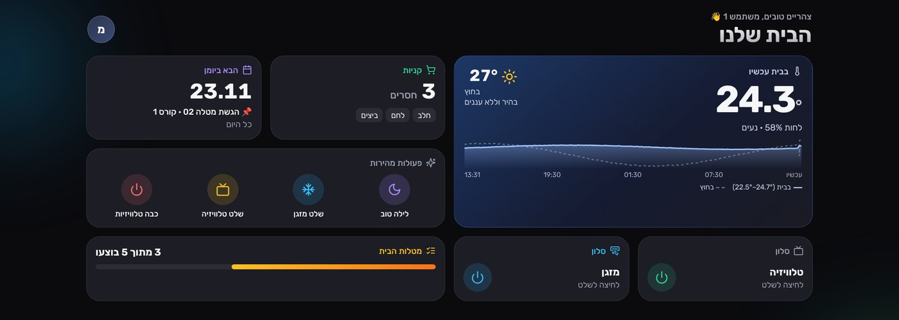
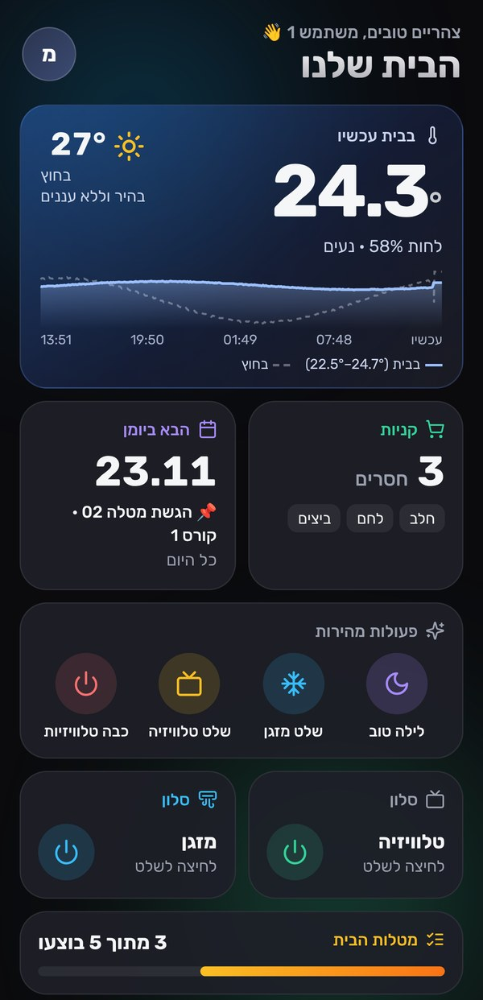
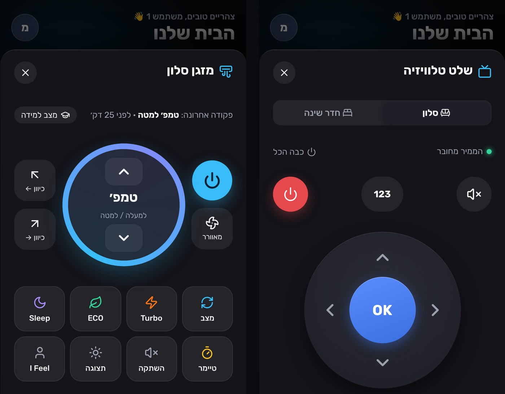
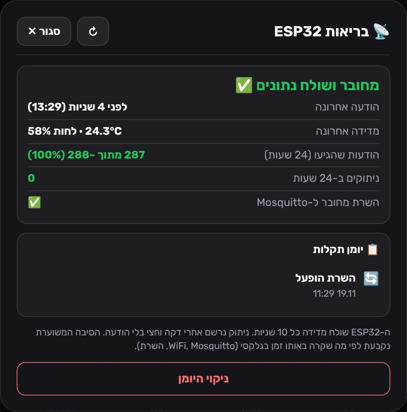
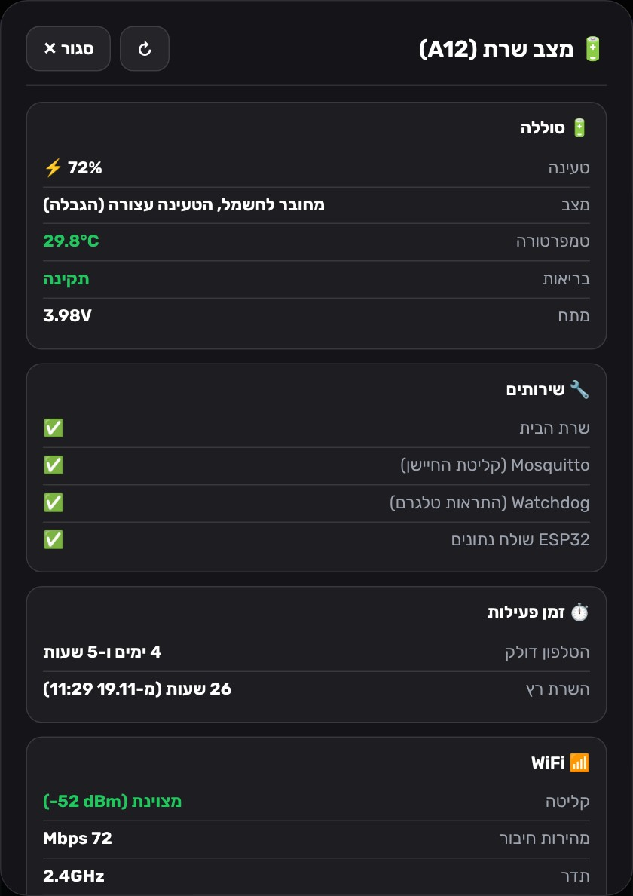
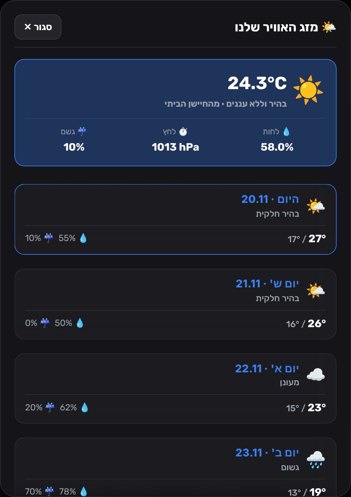
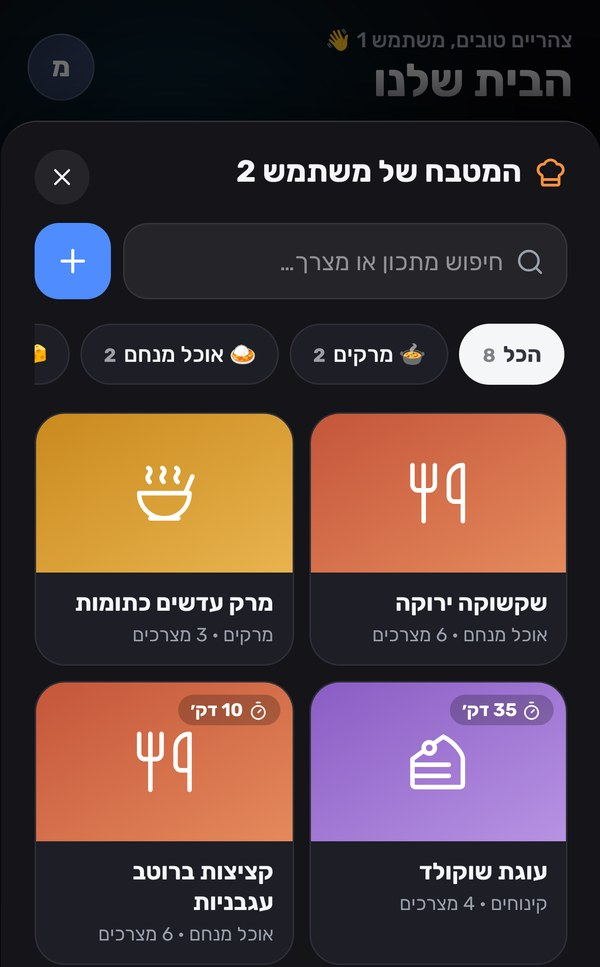
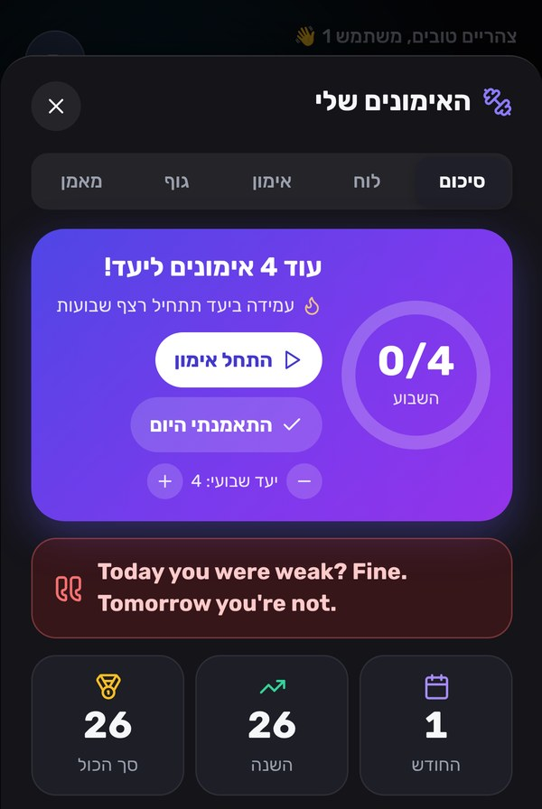
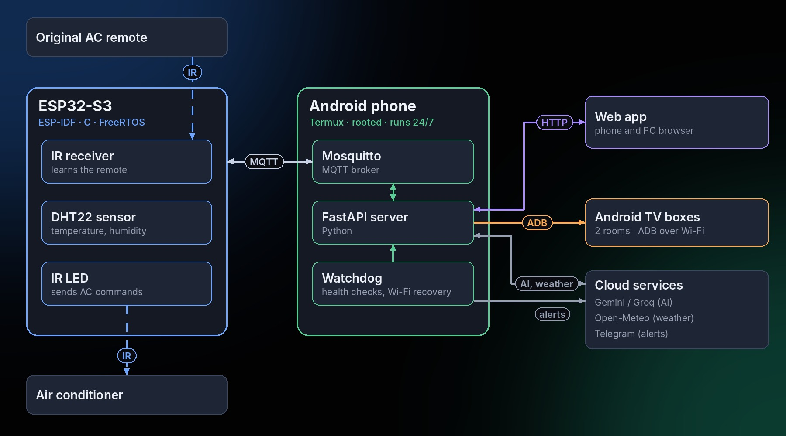

# Smart Home Server

A home automation system that runs on an **old Android phone**. An **ESP32-S3** handles the sensors and the IR remote, and a web app shows everything in one place. It reads the indoor climate, controls the TVs and the air conditioner, keeps track of household tasks, and has an AI assistant that understands commands in Hebrew.

> **Status:** in daily use at home. This repository is an overview of the project; the source code will be published here after a cleanup pass.

  

The interface is in Hebrew (right-to-left). Names and personal details in the screenshots were replaced with placeholders.

---

## What it does

- **Climate monitoring:** an ESP32-S3 with a DHT22 sensor publishes temperature and humidity over MQTT every 10 seconds. The dashboard shows the indoor reading next to the outdoor forecast in a 24-hour graph.
- **AC remote over IR:** the ESP32 *learns* each button from the original AC remote through an IR receiver, then replays the codes on request through an IR LED.
- **TV control:** two Android TV boxes are controlled over the network with ADB (power, navigation, volume, launching apps).
- **AI assistant:** free-text commands such as "turn on the TV in the living room" are turned into actions. It uses Google Gemini, with Groq as a fallback when Gemini is unavailable.
- **Household features:** shopping list, chores, calendar, recipe book, workout and nutrition tracking.
- **Works like a phone app:** on an iPhone the site can be added to the home screen. It then opens full-screen with its own icon, without the browser bars.
- **Self-monitoring:** a watchdog on the phone checks the server, the sensor data, the battery and Wi-Fi. It tries to bring Wi-Fi back by itself and sends Telegram alerts when something goes wrong.

## Screenshots

### Home dashboard

   
  The same dashboard on an iPhone

### Remotes
AC remote (IR, sent by the ESP32) and TV remote (ADB over Wi-Fi).

### Monitoring

<table>
  <tr>
    <td width="50%" valign="top"> <b>ESP32 health:</b> 287 of ~288 expected messages in 24 hours, 0 disconnects</td>
    <td width="50%" valign="top"> <b>Server status:</b> battery, services, uptime and Wi-Fi of the phone</td>
  </tr>
</table>

### Everyday features

<table>
  <tr>
    <td width="50%" valign="top"> <b>AI assistant</b> turning on the living-room TV</td>
    <td width="50%" valign="top"> <b>Weather:</b> indoor sensor reading and outdoor forecast</td>
  </tr>
  <tr>
    <td valign="top"> <b>Recipe book</b></td>
    <td valign="top"> <b>Workout tracker</b></td>
  </tr>
</table>

## Architecture

## Hardware

<!-- TODO: add docs/images/esp32.jpg and docs/images/phone_server.jpg -->

| Part | Role |
|---|---|
| ESP32-S3 (N16R8) | Sensor node and IR remote, written in C with ESP-IDF |
| DHT22 | Temperature and humidity |
| IR receiver + IR LED (driven through a transistor) | Learning and replaying AC remote codes, using the ESP32 RMT peripheral |
| Samsung Galaxy A12 (Android 11, rooted with Magisk) | The server: runs Python, Mosquitto and the watchdog in Termux, starts on boot |

GPIO pins were chosen to avoid the pins used by the octal PSRAM (GPIO35–37) and the strapping pins (GPIO0/45/46).

## Turning an old phone into a 24/7 server

- **Battery care:** rooted with Magisk; the [ACC](https://github.com/VR25/acc) module keeps the battery between 70% and 75% and pauses charging when it gets hot.
- **Less background work:** 38 preinstalled apps and automatic system updates are disabled, and only Wi-Fi is on.
- **Never put to sleep:** Termux is excluded from battery optimization and holds a wake lock.
- **Recovers on its own:** everything starts on boot, and a bootloop-protection module guards against bad Magisk modules.

Uptime at the time of writing: **45 days** without a reboot.

## Engineering highlights

**IR learning on the ESP32.** The backend sends a command name to `home/ac/<room>/learn`. The ESP32 records the matching button from the original remote, then replays it when the same name arrives on `home/ac/<room>/cmd`. A single command can contain several IR packets, which some AC units need.

**Self-healing TV connection.** Android TV boxes drop ADB connections and change IP addresses. The server keeps the connections alive every 45 seconds. When a command fails, it reconnects and retries once. When a box stops answering, it scans the subnet and finds the box again by its serial number, at most once every 5 minutes.

**Reliability you can see.** The server logs every time the ESP32 goes silent and when it comes back, and suggests a probable cause (Wi-Fi, broker or server restart). The *ESP32 health* screen shows how many of the expected messages arrived in the last 24 hours.

**Running on a phone.** The server, the broker and a watchdog run on an old phone in Termux and start automatically on boot. When the phone loses Wi-Fi, the watchdog tries to recover it by toggling Wi-Fi and triggering scans. It also sends Telegram alerts when the server stops, when sensor data stops arriving, or when the battery is low. Inside the server, background tasks that crash are restarted after 30 seconds.

## Tech stack

| Layer | Technologies |
|---|---|
| Firmware | C, ESP-IDF, FreeRTOS, RMT (IR), MQTT client |
| Server | Python, FastAPI, paho-mqtt, Mosquitto, ADB, Termux |
| Front end | HTML, CSS, JavaScript (no framework, no build step) |
| Services | Google Gemini, Groq, Open-Meteo, Telegram Bot API |

## Known limitations and next steps

- Learned IR codes are kept in RAM and are lost when the ESP32 reboots. Next step: store them in NVS flash.
- The site uses plain HTTP and is only reachable inside the home network or through a private VPN (Tailscale). It is not exposed to the internet.
- The MQTT broker accepts connections without a username and password (it is reachable only from the home network). Next step: add authentication.
